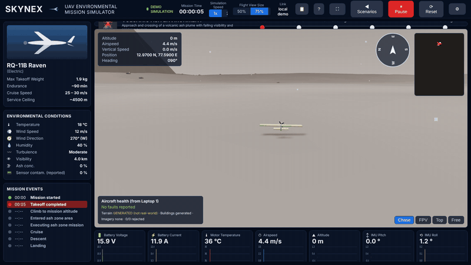
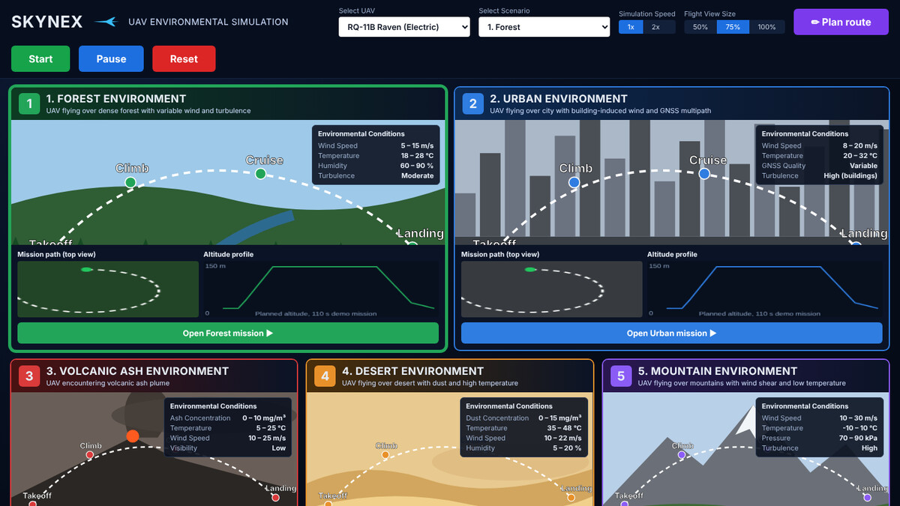
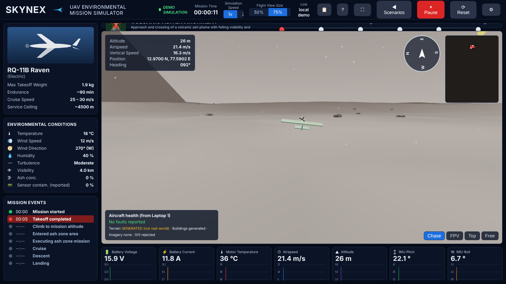
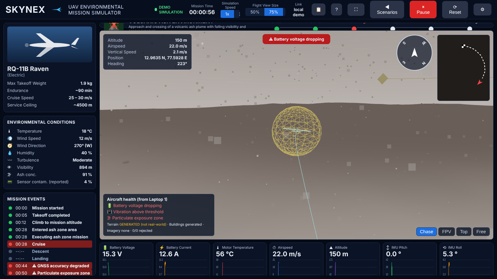

# SKYNEX UAV Environmental Simulation

[](https://github.com/saibharaths7385-maker/dexathon-3d-model-uav-work/actions/workflows/ci.yml)

A browser-based UAV environmental mission simulator: 3D terrain, live telemetry,
faults, a mission report, and a demo that runs with no server and no internet.

**Live demo:** https://saibharaths7385-maker.github.io/dexathon-3d-model-uav-work/



| Lobby | Takeoff | Into the ash plume |
|---|---|---|
|  |  |  |

## Running

- Quick look: open `index.html` (works offline; libraries are in `vendor/`).
- Recommended for the demo: serve the folder so `.glb` models, real-data
  loaders and the service worker work —

  ```bash
  cd skynex-simulator && python -m http.server 8000
  ```

  then open http://localhost:8000

Pick a UAV and scenario in the lobby, press Start (or a card's Open button). Data
is the built-in demo mission, labelled **DEMO SIMULATION**.

## Features

- Lobby with 5 scenario cards, UAV select, Start / Pause / Reset, speed 1x / 2x
- **Flight View Size 50% / 75% / 100%** (lobby and dashboard header) and a browser full-screen button
- **Link health** in the header: RTT, frames/s, dropped and bad frames, last-packet age, schema mismatch warning
- **Alert log** (key `L`): timestamped, severity-tagged, persists across resets; optional audio cue per new fault
- **Mission report** (HTML download): route, altitude profile, peaks, alert timeline, 3D screenshot, with the data source labelled
- **Screenshot** of the 3D view; **save / load recordings** (.json) with a replay scrubber
- Keyboard help overlay (`H` or `?`)
- **Plan route** (lobby): click up to 10 waypoints on a 4 km map and fly them in the demo mission
- **Units toggle** (log panel): metric or imperial readouts (chart axes stay SI)
- **Perf HUD**: fps, draw calls, triangles, quality, pixel ratio, cache hits
- **Cache**: DEM (Open-Meteo) and OSM (Overpass) downloads are kept in IndexedDB for 30 days
- **Touch**: pinch to zoom, one-finger drag; **PWA**: installable and offline when served over http(s)

## Single-file build

`python build.py` inlines the CSS, `js/core.js`, `js/app.js` and the three vendor
libraries into one self-contained `../skynex-simulator-flightview.html` (~1.1 MB)
that runs from `file://` with no server and no internet. Rebuild it after editing
the project files — never hand-edit the single-file HTML. CI fails if the
committed build is stale.

## Models

Give `models/index.json` a map of aircraft to file name, e.g.

```json
{"EAGLE": "eagle-eye-mini.glb", "RAVEN": "rq-11b-raven.glb"}
```

Nothing is probed that is not listed, so an absent model never spams the console
with 404s. See `models/README.txt`.

## Live mode without Laptop 1

```bash
python tools/mock_server.py --aircraft RQ11B --scenario DESERT
```

In the viewer open the gear menu, set `ws://127.0.0.1:8000/ws/3d-simulator`, press
**Connect live**. Fault injection: `--drop 0.1` loses 10% of frames;
`--stall-at 20 --stall-for 8` freezes the stream to show the stale-data banner.
The server is stdlib-only Python; `websockets` is needed just for its test.

Frame format: `docs/frames.md`. Tests:

- `node tools/run_tests.js` (or open `tests.html`): pure helpers in `core.js`
- `node tools/ingest_test.js`: headless Chromium (needs `npm i playwright`); smoke test (Start, mission clock runs, zero console errors) plus `ingest()` clamping, seq/reconnect watermark, fault dedupe, batch resets, and a replay of `fixtures/frames.json`
- `python tools/test_mock_server.py`
- `node tools/make_fixture.js` regenerates the fixture from the demo generator

## Data honesty

Demo mode and the mock server are synthetic. Reports label their source
(DEMO / LIVE / MANUAL). Humidity and visibility are demo values unless your live
feed supplies them.

## Repo

The workflows live at the repository root (`.github/workflows/`), because GitHub
ignores workflow files anywhere else. `ci.yml` syntax-checks the app, runs the unit
tests, the `ingest()` browser tests and the mock-server test, and verifies the
single-file build is current. `pages.yml` publishes this folder to GitHub Pages once
Pages is switched on for the repository (Settings > Pages > Source: GitHub Actions —
one click, and it can only be done by the owner). Until then that job skips with a
notice instead of failing.
MIT licence in `LICENSE` (third-party notices in `vendor/LICENSE-three.txt`).
